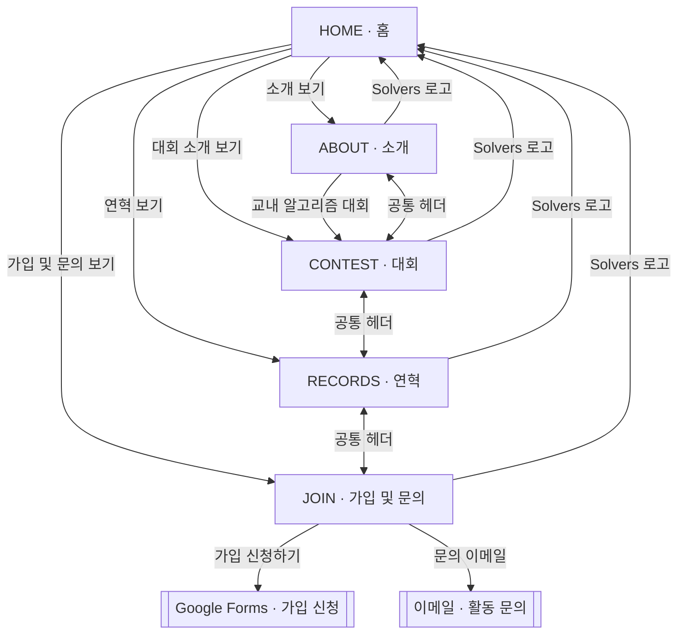

# Solvers 홈페이지 설계

## 1. 서비스 개요

Solvers 홈페이지는 한신대학교 알고리즘 소모임의 활동을 소개하고 가입으로 연결하는 홍보 사이트다.

- 소모임 표어: `We make better solvers.`
- 주요 활동: 스터디, 교내 대회 개최, 외부 대회 참여
- 주요 방문자: 한신대학교 재학생, 가입 희망자, 교내 대회 참가자
- 지원 환경: 데스크톱과 모바일 웹 브라우저
- 공개 주소: `https://hanshin-solvers.github.io/homepage/`

## 2. 핵심 경험

1. 홈에서 Solvers의 성격과 네 가지 핵심 영역을 한 화면에 파악한다.
2. 소개에서 활동과 초급반·중급반의 학습 범위를 확인한다.
3. 대회에서 연도와 시즌을 선택해 해당 대회의 포스터와 정보를 확인한다.
4. 연혁에서 운영진과 외부 대회 성적을 연도별로 확인한다.
5. 가입 및 문의에서 Google Forms와 이메일로 바로 이동한다.

## 3. 정보 구조

| 경로                 | 화면         | 핵심 콘텐츠                               |
| -------------------- | ------------ | ----------------------------------------- |
| `/homepage/`         | 홈           | 소개, 대회, 연혁, 가입 및 문의 챕터       |
| `/homepage/about/`   | 소개         | 소모임 소개, 스터디, 대회 개최, 대회 참여 |
| `/homepage/contest/` | 대회         | 연도·시즌 선택, 포스터, 일시, 장소        |
| `/homepage/records/` | 연혁         | 운영진, 연도별 외부 대회 성적             |
| `/homepage/join/`    | 가입 및 문의 | 가입 신청 링크, 담당자 이메일             |

### 화면 이동



상세 화면의 공통 헤더는 `Solvers`, `소개`, `대회`, `연혁`, `가입 및 문의` 링크를 제공한다.

## 4. 공통 시각 자원과 적용 범위

메인 화면의 서식은 5절, 네 상세 페이지의 서식은 6절을 기준으로 한다. 6.1의 공통 서식은 소개·대회·연혁·가입 및 문의에 적용하며, 각 페이지의 고유 요소는 6.2~6.5에 명시한다.

| 역할 | 색상 | 적용 대상 |
| --- | --- | --- |
| 배경 | `#ffffff` | 전체 화면 |
| 기본 표면 | `#f7f9fb` | 메인 챕터 선택 영역, 대회 시상 표의 열 제목 |
| 강조 표면 | `#f2f3f5` | 버튼·탭의 호버 상태 |
| 본문 | `#191f28` | 제목, 본문 |
| 링크 강조 | `#1565c0` | 대회 설명 본문의 링크 |
| 보조 본문 | `#6b7684` | 항목명, 날짜, 보조 안내, 현재 섹션 표시 |
| 학교 상징색 | `#472f91` | 메인 선택 챕터·이동 링크, 선택 기간 탭, 대회 표어 |
| 진한 상징색 | `#33206f` | 메인 이동 링크의 상호작용 상태 |
| 경계선 | `#e5e8eb` | 헤더·푸터, 상세 페이지의 큰 섹션, 버튼·탭 테두리 |
| 비활성 목차 | `#b9bec6` | 대회 섹션 내비게이션의 일반 항목 |

- 워드마크: Montserrat Alternates, Thin `100`.
- 기본 글꼴: Pretendard 계열과 시스템 sans-serif 대체 글꼴.
- 대회명·영문 풀네임·대회 표어: 본명조(Noto Serif KR), `400`.

## 5. 메인 화면 서식 — `/homepage/`

**적용 대상:** 메인의 소개·대회·연혁·가입 및 문의 챕터.

- 콘텐츠와 챕터 선택 영역으로 `100svh`를 채운다. 메인은 전용 전체 화면 레이아웃을 사용한다.
- 챕터 순서는 소개, 대회, 연혁, 가입 및 문의다.
- `860px` 초과 화면: 왼쪽 콘텐츠, 오른쪽 세로형 4개 챕터 버튼.
- `860px` 이하 화면: 콘텐츠 아래에 가로형 4개 챕터 버튼.
- 영문 제목 크기: 큰 화면 `48~76px`, `860px` 이하 `42~62px`, `560px` 이하 `36~48px` 범위에서 화면 폭에 맞춰 조절한다.
- 설명 글자: 기본 `17px`·행간 `1.7`, `560px` 이하 `14px`·행간 `1.6`.
- 상세 페이지 이동 링크: `14px`, 학교 상징색, 이동 표시.
- 긴 영문 제목은 모바일에서 지정된 두 단어 단위로 줄을 구성한다.
- 표어, 설명, 상세 페이지 이동 링크를 콘텐츠 영역 하단에 정렬한다.
- 소개·대회·연혁은 WebP 사진을 배경으로 채우고, 하단의 어두운 그라데이션 위에 흰색 글자를 배치한다. 가입 및 문의는 기존 흰색 배경을 사용한다.
- 챕터는 5초 간격으로 순환하며, 챕터 버튼 선택 시 즉시 전환한다.

## 6. 상세 페이지 서식

### 6.1 네 페이지 공통 기준

**적용 대상:** `/about/`, `/contest/`, `/records/`, `/join/`. 경로는 모두 `/homepage` 아래에 위치한다.

네 상세 페이지는 아래 공통 서식을 적용한다. 대회명·영문명·표어는 6.3의 전용 서식을 적용한다.

| 요소 | 공통 서식 |
| --- | --- |
| 가로 배치 | 헤더·본문·푸터의 중앙 축과 최대 폭 `960px` 공유 |
| 화면 좌우 여백 | 기본 최소 `24px`, `560px` 이하 최소 `16px` |
| 페이지 제목 | PC `36px`·모바일 `28px`, 굵기 `700`, 행간 `1.2` |
| 제목 영역 | 위 `32px`, 아래 `20px` 여백 |
| 본문 영역 | 위 `12px`, 아래 `32px` 여백 |
| 큰 섹션 제목 | PC `24px`·모바일 `22px`, 굵기 `700`, 행간 `1.4`, 아래 여백 `24px` |
| 하위 콘텐츠 제목 | 아래 제목 단계 표 적용 |
| 본문 | PC `17px`·모바일 `16px`, 굵기 `400`, 행간 `1.8`, 본문 색 |
| 항목명 | PC `15px`·모바일 `14px`, 굵기 `400`, 행간 `1.8`, 보조 본문 색 |
| 큰 섹션 경계 | `1px` 회색 구분선, 선 위아래 여백 각각 PC `28px`·모바일 `24px` |
| 같은 수준의 활동·기록 간격 | PC `28px`·모바일 `24px` |
| 기간 탭 | 가운데 정렬, 아래 여백 `32px`, 선택 탭에 학교 상징색 |
| 일반 본문 링크 | 기본 본문 색, `1px` 밑줄, 밑줄 간격 `3px`. 대회 설명에서는 파란색 `#1565c0` 적용 |
| 이메일 링크 | 일반 텍스트 형태, 클릭 시 메일 작성. 기본 본문 색을 사용하며 대회 설명에서는 파란색 적용 |
| 버튼형 링크 | 기본 본문 색의 글자와 테두리로 클릭 동작 표현 |

- 공통 기준을 적용하는 페이지는 같은 화면 폭에서 제목의 시작 위치와 크기를 일치시킨다.
- 데스크톱과 모바일은 같은 정보 순서와 글꼴 체계를 공유한다.
- 가입 및 문의의 항목명/내용 행은 `140px + 나머지 폭`, 열 간격 `16px`을 사용한다. `560px` 이하에서는 항목명 위·내용 아래로 배치하고 사이를 `4px` 띄운다. 대회는 6.3의 목록 서식을 적용한다.
- 한글 본문은 단어 단위 줄바꿈을 우선하고, 긴 주소는 가용 폭에 맞춰 줄바꿈한다.
- 공통 헤더는 워드마크와 네 개의 페이지 링크를 한 줄에 배치한다.
- 헤더·푸터 경계선은 유지하며, 짧은 페이지의 푸터는 화면 하단에 배치한다.
- 푸터는 저작권 문구와 소모임 표어를 표시한다.
- 공통 서식은 `src/styles/detail.css`, 각 화면의 고유 요소는 `src/styles/global.css`에서 관리한다.

#### 공통 제목 단계와 배치

| 단계 | 역할·예시 | PC (`641px` 이상) | 모바일 (`640px` 이하) | 굵기 |
| --- | --- | --- | --- | --- |
| 페이지명 `h1` | 소개·대회·연혁·가입 및 문의 | `36px` | `28px` | `700` |
| 제목 `h2` | 개별 활동·대회 안내 섹션·운영진·외부 대회 성적·가입·문의 | `24px` | `22px` | `700` |
| 중제목 `h3` | 초급반·중급반·외부 대회명·상세 일정·채점 방식·도구 사용 기준 | `20px` | `19px` | `700` |
| 소제목 `h4` | 중제목 아래의 세부 분류 | `18px` | `17px` | `600` |
| 본문 | 설명 문장 | `17px` | `16px` | `400` |

- 헤더·본문·푸터는 중앙 축과 최대 폭 `960px`를 공유하며, 기존 화면 좌우 여백을 적용한다.
- PC와 모바일 모두 제목 아래에 설명을 두는 세로 흐름으로 배치한다. 페이지명부터 소제목까지 내용의 소속 관계에 따라 순서대로 사용한다.
- 본문 행간은 `1.8`이며 문장은 가용 폭에 맞춰 자연스럽게 줄바꿈한다.
- 제목 아래 `24px`, 중제목 아래 `12px`, 소제목 아래 `8px`의 간격을 적용한다. 섹션 사이 구분선의 위아래 여백은 PC `28px`·모바일 `24px`로 한다.
- 항목명과 날짜는 PC `15px`·모바일 `14px`의 보조 본문 색으로 표시한다. 버튼과 기록 링크의 글자는 본문 크기를 따른다.
- 공통 서식은 `src/styles/detail.css`의 `reading-page` 클래스로 공유한다.
- 첫 콘텐츠 앞에도 같은 구분선을 적용한다. 소개는 소개 문장 아래, 대회·연혁은 기간 탭 아래, 가입 및 문의는 가입 섹션 위에 배치한다.

### 6.2 소개 — `/homepage/about/`

**순서:** 페이지 제목 → 소개 문장 → 스터디·대회 개최·대회 참여.

- 6.1의 공통 서식을 적용한다. 소개 문장과 구분선 사이 간격은 PC `28px`·모바일 `24px`로 한다.
- 초급반·중급반은 스터디 설명 아래 PC `24px`·모바일 `20px`에 배치한다. 들여쓰기는 PC `20px`·모바일 `16px`, 반 사이 간격은 `20px`로 한다.
- 활동과 스터디의 고유 배치는 `src/pages/about/index.astro`에서 관리한다.
- 교내 알고리즘 대회 링크: 공통 링크 색과 밑줄, 대회 페이지로 이동.

### 6.3 대회 — `/homepage/contest/`

**순서:** 페이지 제목 → 기간 탭 → 선택한 대회의 콘텐츠.

- 기간 탭: `연도: 시즌`, 최신 기간 우선, 같은 연도는 Fall → Spring. 선택 기간 한 건을 표시한다.
- 상세 안내 순서: 대회 소개 → 일정 및 장소 → 참가 자격 → 참가 신청 → 시상 안내 → 문제 안내 → 채점 및 순위 산정 → 참가자 유의사항 → 문의. 오른쪽 섹션 내비게이션도 같은 순서로 배치한다.
- 참가 자격에는 참가 대상과 트랙 배정 방식을, 참가 신청에는 신청 기간과 신청 링크를 표시한다. 문제 안내는 문항 수·범위·난이도·출제 경향을 다루고, 채점 및 순위 산정은 플랫폼 → 사용 언어·컴파일러 정보 → 언어별 풀이 가능 보장 범위 → 채점 방식 → 순위 기준 순서로 구성한다. 미정인 내용은 `추가 예정`으로 표시한다.
- 아홉 큰 섹션은 `h2`, 상세 일정·트랙 배정·채점·순위 산정·유의사항의 각 기준은 `h3`로 구성하고 공통 제목·본문·구분선 서식을 적용한다.
- 안내 본문은 bullet 목록으로 구성한다. 짧은 정보는 `항목명: 내용` 한 흐름으로 표시하고 항목명은 굵기 `600`으로 강조한다. 대상 조건·난이도·허용 도구·참고 링크는 관련 항목 아래의 하위 목록에 배치한다.
- 참가자 유의사항은 준비물 → 참고 자료와 사전 코드 → IDE·AI·기타 도구 → 대회 진행 중 유의사항 순서로 배치한다. 소통·질문·위반 처리는 ‘대회 진행 중 유의사항’ 소제목 아래 같은 단계의 bullet로 묶는다. 소제목 사이는 공통 간격을 적용하고 구분선은 큰 섹션 사이에 적용한다.
- 참고 자료의 소개 문장 아래에 언어별 레퍼런스 사이트와 알고리즘 노트를 같은 단계로 배치한다. 언어 링크와 노트 사용 규칙은 각각 해당 자료의 하위 목록에 표시한다.
- 목록 들여쓰기는 단계마다 `1.4em`, 항목 사이와 하위 목록 위 간격은 `8px`로 한다. 상위 목록은 채운 원, 하위 목록은 빈 원으로 구분하고 줄바꿈된 문장은 본문 시작선에 맞춘다. PC와 모바일에 같은 목록 구조를 적용한다.
- 대회명: 본명조 `400`, 큰 화면 `49.5px`·행간 `1.3`. `640px` 이하에서는 `clamp(30px, 10vw, 49.5px)`로 조절한다.
- 영문 풀네임: 본명조 `14px`, 보조 본문 색, 대회명 아래 간격 `2px`.
- 표어: 본명조 `22~26px`, 학교 상징색, 풀네임 아래 간격 `24px`.
- 시상 표: 첫 열은 상명과 트랙별 인원을 `상명(인원)`으로 표시하고, 이후 각 트랙 열에는 상금을 표시한다. 행·열 제목은 굵기 `700`으로 표시한다. 열 제목에 `#f7f9fb` 배경을 적용하고 셀 내부 여백은 위아래 `12px`·좌우 `6px`로 한다. 짧은 항목은 중앙 정렬, 긴 설명은 왼쪽 정렬한다. 행·열 구분선과 표의 바깥쪽 네 면에 동일한 `1px` 회색 테두리를 적용한다.
- 상세 일정은 `시간: 일정 내용` 목록으로 표시한다.
- 대회 날짜는 `M월 D일(요일)`, 시각은 24시간제 `HH:mm`으로 표기한다. 시간 범위는 `HH:mm ~ HH:mm`, 신청 기한은 `M월 D일(요일) HH:mm`으로 통일한다.
- 트랙별 대상은 트랙 이름을 강조한 상위 항목과 참가 조건을 담은 하위 목록으로 구성한다.
- 채점 플랫폼·컴파일러 정보·레퍼런스: 링크 문구에 공통 파란색과 밑줄을 적용한다. 이메일은 공통 이메일 서식을 적용한다.
- 포스터: 원본 비율을 유지하며 화면 높이에 맞춰 크기를 조절한다.
- 오른쪽 선형 목차: 두께 `2px`, 일반 항목 길이 `12px`·옅은 회색, 현재 항목 길이 `20px`·진한 회색. 항목 클릭 영역은 `36×44px`.
- 선형 목차는 화면 세로 중앙에 고정하고 최대 폭 `960px`의 본문 오른쪽 여백에 배치한다. `1048px` 이하에서는 본문 안쪽 오른쪽에 `28px` 공간을 확보한다.
- 긴 콘텐츠는 휠·터치·키보드 스크롤로 탐색하며 기본 스크롤바는 숨김 처리한다.

### 6.4 연혁 — `/homepage/records/`

**순서:** 페이지 제목 → 연도 탭 → 운영진 → 외부 대회 성적.

- 연도 탭: 최신 연도 기본 선택, 선택 연도의 성적 표시.
- 운영진·외부 대회 성적은 `h2`, 개별 대회명은 `h3`로 구성하고 6.1의 공통 서식을 적용한다.
- 운영진: 직책·이름·연락처의 3열 구성. 항목명과 값 사이 `7px`.
- 운영진 열 폭: 기본 `96px / 96px / 나머지`, 간격 `24px`. `560px` 이하에서는 `64px / 64px / 나머지`, 간격 `12px`.
- 대회명과 예선·본선은 같은 중제목에 표시한다. 날짜는 제목 옆 보조 본문으로 배치하고 공간에 따라 줄바꿈한다.
- 대회명은 PC `20px`·모바일 `18px`로 표시한다. 상위 제목인 외부 대회 성적은 PC `24px`·모바일 `22px`로 표시한다. PC에서는 성적·팀·참가자 3열로 정렬하며 열 너비는 `18% / 26% / 나머지`다. 모바일에서는 한 성적 안에서 성적 → 팀 → 참가자를 항목명과 함께 세로로 배치한다.
- 팀전과 개인전의 닉네임은 동일한 본문 크기·색상·굵기 `400`을 사용한다. 팀명과 성적은 굵기로 구분하고, 데이터가 없는 항목은 `—`로 표시한다. 표의 항목명은 옅은 회색 배경과 보조 본문으로, 성적 행은 아래 경계선으로 구분한다.
- 연혁은 휠·터치·키보드 스크롤을 지원하며 스크롤바는 숨긴다.
- 성적은 `31st`, `122nd`처럼 영문 서수로 표시한다.
- 같은 대회의 팀별 성적은 한 표에 묶는다. 같은 연도의 대회는 날짜 오름차순, 대회 간 간격은 `40px`로 배치한다. 모바일에서는 팀원 닉네임을 화면 폭에 맞춰 줄바꿈한다.
- 운영진 이메일은 공통 이메일 서식, 관련 기록 링크는 공통 일반 링크 서식을 적용한다.

### 6.5 가입 및 문의 — `/homepage/join/`

**순서:** 페이지 제목 → 가입 → 문의. 두 영역은 한 페이지에서 제공한다.

- 가입·문의는 `h2`로 구성하고 6.1의 공통 서식을 적용한다.
- 가입 버튼: Google Forms 외부 링크, 흰 배경·회색 `1px` 테두리·모서리 `10px`, 본문 크기와 색의 글자.
- 가입 버튼 크기: 기본 내용에 맞춘 폭과 최소 높이 `46px`. `560px` 이하에서는 본문 전체 폭과 최소 높이 `48px`.
- QR 이미지가 등록되면 가입 영역에 원본 비율을 유지한 정사각형 이미지로 표시한다.
- 문의: 담당자·이메일 두 행, 공통 서식의 항목명·본문 크기와 반응형 항목 배치 적용.
- 이메일: 공통 이메일 서식, 클릭 시 메일 작성.

## 7. 콘텐츠 관리

Astro Content Collections와 Markdown 파일을 사용한다. 실제 문구, 일정, 연락처와 성적은 `src/content`의 Markdown을 단일 기준으로 관리한다.

```text
src/content/
├── home/index.md
├── about/index.md
├── studies/index.md
├── contests/[year]-[season].md
├── members/[slug].md
├── competitions/[slug].md
└── join/index.md
```

| 컬렉션         | 관리 내용           | 주요 필드                                                     |
| -------------- | ------------------- | ------------------------------------------------------------- |
| `home`         | 홈의 네 챕터        | `title`, `slogan`, `chapters`                                 |
| `about`        | 소개와 세 가지 활동 | `title`, `intro`, `activities`                                |
| `studies`      | 초급반과 중급반     | `title`, `intro`, `tracks`                                    |
| `contests`     | 교내 대회           | `year`, `season`, `summary`, `schedule`, `location`, `images` |
| `members`      | 운영진              | `name`, `role`, `email`, `order`                              |
| `competitions` | 외부 대회 성적      | `title`, `year`, `date`, `division`, `summary`, `result`      |
| `join`         | 가입과 문의         | `apply`, `contact`                                            |

새 교내 대회 Markdown 파일은 대회 기간 탭에 연결된다. 새 외부 대회 성적의 연도는 연혁의 연도 탭에 연결된다.

이미지 자산은 `public/images`에서 관리하며 Markdown에는 `/images/...` 경로를 작성한다.

## 8. 접근성과 상호작용

- 챕터와 기간 선택은 `tablist`, `tab`, `tabpanel` 구조를 사용한다.
- 기간 탭은 좌우 방향키, Home, End 키를 지원한다.
- 현재 화면과 선택 상태는 `aria-current`, `aria-selected`로 전달한다.
- 포스터 이미지는 대회명을 포함한 대체 텍스트를 제공한다.
- 링크와 버튼은 키보드 포커스와 터치 입력을 지원한다.
- 사용자의 모션 설정에 따라 전환 시간을 조절한다.

## 9. 빌드와 배포

- 프레임워크: Astro 정적 사이트
- 사이트 기준 주소: `https://hanshin-solvers.github.io`
- 배포 기준 경로: `/homepage`
- 콘텐츠 검사와 빌드: `npm run build`
- CI: Pull Request와 `main` push에서 콘텐츠 검사와 정적 빌드 실행
- 배포: `main` push와 수동 실행에서 GitHub Pages 배포
- GitHub Pages Source: GitHub Actions

Markdown과 코드 변경 사항을 `main` 브랜치에 반영하면 GitHub Actions가 사이트를 검사하고 배포한다.
