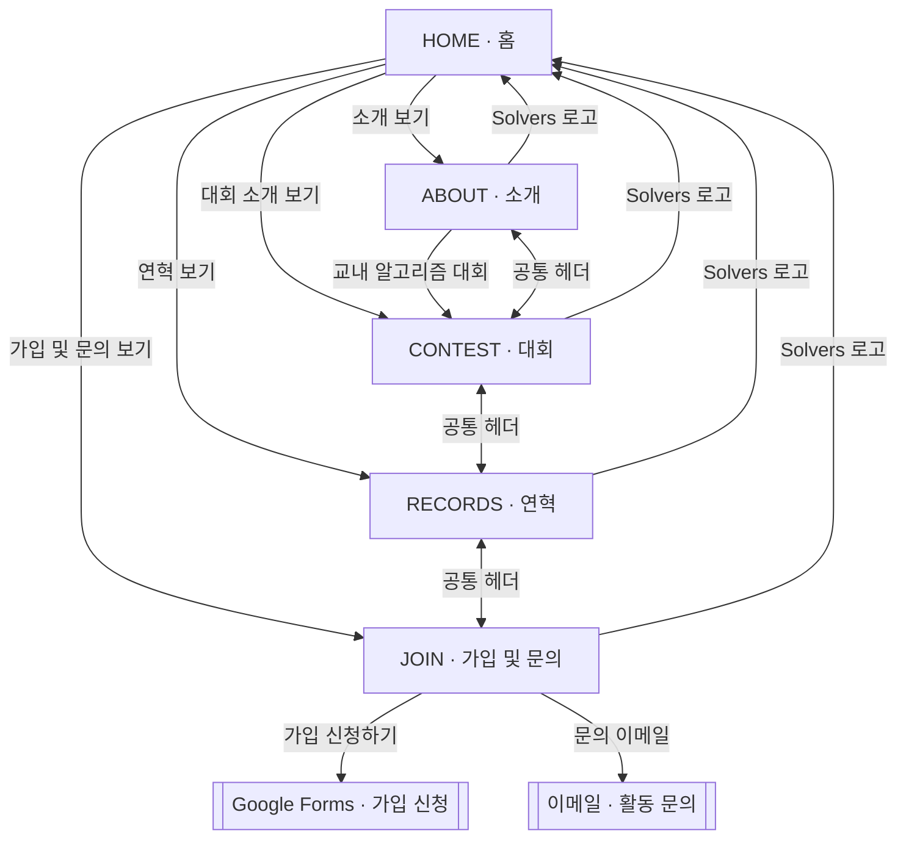

# Solvers 홈페이지 설계

## 1. 서비스 개요

Solvers 홈페이지는 한신대학교 알고리즘 소모임의 활동을 소개하고 가입으로 연결하는 홍보 사이트다.

- 소모임 표어: `We make better solvers.`
- 주요 활동: 스터디, 교내 대회 개최, 외부 대회 참여
- 주요 방문자: 한신대학교 재학생, 가입 희망자, 교내 대회 참가자
- 지원 환경: 데스크톱과 모바일 웹 브라우저
- 공개 주소: `https://hanshin-solvers.github.io/homepage/`

## 2. 핵심 경험

1. 홈에서 Solvers의 성격과 네 가지 핵심 영역을 한 화면에 파악한다.
2. 소개에서 활동과 초급반·중급반의 학습 범위를 확인한다.
3. 대회에서 연도와 시즌을 선택해 해당 대회의 포스터와 정보를 확인한다.
4. 연혁에서 운영진과 외부 대회 성적을 연도별로 확인한다.
5. 가입 및 문의에서 Google Forms와 이메일로 바로 이동한다.

## 3. 정보 구조

| 경로                 | 화면         | 핵심 콘텐츠                               |
| -------------------- | ------------ | ----------------------------------------- |
| `/homepage/`         | 홈           | 소개, 대회, 연혁, 가입 및 문의 챕터       |
| `/homepage/about/`   | 소개         | 소모임 소개, 스터디, 대회 개최, 대회 참여 |
| `/homepage/contest/` | 대회         | 연도·시즌 선택, 포스터, 일시, 장소        |
| `/homepage/records/` | 연혁         | 운영진, 연도별 외부 대회 성적             |
| `/homepage/join/`    | 가입 및 문의 | 가입 신청 링크, 담당자 이메일             |

### 화면 이동



상세 화면의 공통 헤더는 `Solvers`, `소개`, `대회`, `연혁`, `가입 및 문의` 링크를 제공한다.

## 4. 공통 시각 자원과 적용 범위

메인 화면의 서식은 5절, 네 상세 페이지의 서식은 6절을 기준으로 한다. 6.1의 공통 서식은 소개·대회·연혁·가입 및 문의에 적용하며, 각 페이지의 고유 요소는 6.2~6.5에 명시한다.

| 역할 | 색상 | 적용 대상 |
| --- | --- | --- |
| 배경 | `#ffffff` | 전체 화면 |
| 기본 표면 | `#f7f9fb` | 메인 챕터 선택 영역, 대회 시상 표의 열 제목 |
| 강조 표면 | `#f2f3f5` | 버튼·탭의 호버 상태 |
| 본문 | `#191f28` | 제목, 본문, 상세 페이지의 링크 |
| 보조 본문 | `#6b7684` | 항목명, 날짜, 보조 안내, 현재 섹션 표시 |
| 학교 상징색 | `#472f91` | 메인 선택 챕터·이동 링크, 선택 기간 탭, 대회 표어 |
| 진한 상징색 | `#33206f` | 메인 이동 링크의 상호작용 상태 |
| 경계선 | `#e5e8eb` | 헤더·푸터, 상세 페이지의 큰 섹션, 버튼·탭 테두리 |
| 비활성 목차 | `#b9bec6` | 대회 섹션 내비게이션의 일반 항목 |

- 워드마크: Montserrat Alternates, Thin `100`.
- 기본 글꼴: Pretendard 계열과 시스템 sans-serif 대체 글꼴.
- 대회명·영문 풀네임·대회 표어: 본명조(Noto Serif KR), `400`.

## 5. 메인 화면 서식 — `/homepage/`

**적용 대상:** 메인의 소개·대회·연혁·가입 및 문의 챕터.

- 콘텐츠와 챕터 선택 영역으로 `100svh`를 채운다. 메인은 전용 전체 화면 레이아웃을 사용한다.
- 챕터 순서는 소개, 대회, 연혁, 가입 및 문의다.
- `860px` 초과 화면: 왼쪽 콘텐츠, 오른쪽 세로형 4개 챕터 버튼.
- `860px` 이하 화면: 콘텐츠 아래에 가로형 4개 챕터 버튼.
- 영문 제목 크기: 큰 화면 `48~76px`, `860px` 이하 `42~62px`, `560px` 이하 `36~48px` 범위에서 화면 폭에 맞춰 조절한다.
- 설명 글자: 기본 `17px`·행간 `1.7`, `560px` 이하 `14px`·행간 `1.6`.
- 상세 페이지 이동 링크: `14px`, 학교 상징색, 이동 표시.
- 긴 영문 제목은 모바일에서 지정된 두 단어 단위로 줄을 구성한다.
- 표어, 설명, 상세 페이지 이동 링크를 콘텐츠 영역 하단에 정렬한다.
- 챕터는 5초 간격으로 순환하며, 챕터 버튼 선택 시 즉시 전환한다.

## 6. 상세 페이지 서식

### 6.1 네 페이지 공통 기준

**적용 대상:** `/about/`, `/contest/`, `/records/`, `/join/`. 경로는 모두 `/homepage` 아래에 위치한다.

| 요소 | 공통 서식 |
| --- | --- |
| 가로 배치 | 헤더·본문·푸터의 중앙 축과 최대 폭 `800px` 공유 |
| 화면 좌우 여백 | 기본 최소 `24px`, `560px` 이하 최소 `16px` |
| 페이지 제목 | `clamp(28px, 3vw, 32px)`, 굵기 `700`, 행간 `1.08` |
| 제목 영역 | 위 `32px`, 아래 `20px` 여백 |
| 본문 영역 | 위 `12px`, 아래 `32px` 여백 |
| 큰 섹션 제목 | `18px`, 굵기 `700`, 행간 `1.5`, 아래 여백 `18px` |
| 하위 콘텐츠 제목 | `16px`, 굵기 `600`, 행간 `1.5` |
| 본문 | `15px`, 굵기 `400`, 행간 `1.75`, 본문 색 |
| 항목명 | `14px`, 굵기 `400`, 행간 `1.75`, 보조 본문 색 |
| 큰 섹션 경계 | `1px` 회색 구분선, 선 위아래 여백 각각 `28px` |
| 같은 수준의 활동·기록 간격 | `28px` |
| 기간 탭 | 가운데 정렬, 아래 여백 `32px`, 선택 탭에 학교 상징색 |
| 일반 본문 링크 | 본문 색, `1px` 밑줄, 밑줄 간격 `3px` |
| 이메일 링크 | 본문과 같은 색의 일반 텍스트 형태, 클릭 시 메일 작성 |
| 버튼형 링크 | 테두리와 이동 표시로 클릭 동작 표현 |

- 제목의 시작 위치와 크기는 같은 화면 폭에서 네 페이지가 일치한다.
- 데스크톱과 모바일은 같은 정보 순서와 글꼴 체계를 공유한다.
- 대회·문의의 항목명/내용 행은 `140px + 나머지 폭`, 열 간격 `16px`을 사용한다. `560px` 이하에서는 항목명 위·내용 아래로 배치하고 사이를 `4px` 띄운다.
- 한글 본문은 단어 단위 줄바꿈을 우선하고, 긴 주소는 가용 폭에 맞춰 줄바꿈한다.
- 공통 헤더는 워드마크와 네 개의 페이지 링크를 한 줄에 배치한다.
- 헤더·푸터 경계선은 유지하며, 짧은 페이지의 푸터는 화면 하단에 배치한다.
- 푸터는 저작권 문구와 소모임 표어를 표시한다.
- 공통 서식은 `src/styles/detail.css`, 각 화면의 고유 요소는 `src/styles/global.css`에서 관리한다.

### 6.2 소개 — `/homepage/about/`

**순서:** 페이지 제목 → 소개 문장 → 활동 → 스터디·대회 개최·대회 참여.

- 소개 문장: 본문 서식 `15px`, 아래 여백 `28px`.
- 활동: 큰 섹션 제목 `18px`.
- 스터디·대회 개최·대회 참여: 하위 제목 `16px`와 본문 `15px`의 문단 구조, 활동 간격 `28px`.
- 초급반·중급반: 스터디 문단 아래 `18px`, 왼쪽 들여쓰기 `20px`. 반 이름 `16px`, 설명 `15px`, 반 사이 간격 `16px`.
- 활동 내부는 문단과 들여쓰기로 계층을 표현한다.
- `560px` 이하에서 콘텐츠에 지정한 줄바꿈을 적용한다.
- 교내 알고리즘 대회 링크: 본문 색과 밑줄, 대회 페이지로 이동.

### 6.3 대회 — `/homepage/contest/`

**순서:** 페이지 제목 → 기간 탭 → 선택한 대회의 콘텐츠.

- 기간 탭: `연도: 시즌`, 최신 기간 우선, 같은 연도는 Fall → Spring. 선택 기간 한 건을 표시한다.
- 상세 안내 순서: 대회 소개 → 참가 안내 → 시상 안내 → 일정 및 장소 → 진행 방식 → 참가자 유의사항 → 문의.
- 일곱 큰 섹션: 공통 `18px` 제목과 구분선·여백 적용.
- 대회명: 본명조 `400`, 큰 화면 `49.5px`·행간 `1.3`. `640px` 이하에서는 `clamp(30px, 10vw, 49.5px)`로 조절한다.
- 영문 풀네임: 본명조 `14px`, 보조 본문 색, 대회명 아래 간격 `2px`.
- 표어: 본명조 `22~26px`, 학교 상징색, 풀네임 아래 간격 `24px`.
- 시상 표: 첫 열은 구분, 이후 각 열은 트랙. 열 제목에 `#f7f9fb` 배경을 적용하고 셀 내부 여백은 `12px`로 한다. 표 내부는 배경과 여백으로 구분한다.
- 시간표: 왼쪽 시간 `124px`, 오른쪽 일정 내용, 열 간격 `16px`, 행 간격 `12px`.
- 트랙별 대상: 트랙 이름 `16px`, 대상 목록 `15px`, 트랙 사이 간격 `24px`.
- 채점 플랫폼·레퍼런스: 본문 색, 밑줄, 외부 이동 표시 `↗`. 이메일은 공통 이메일 서식을 적용한다.
- 포스터: 원본 비율을 유지하며 화면 높이에 맞춰 크기를 조절한다.
- 오른쪽 선형 목차: 두께 `2px`, 일반 항목 길이 `12px`·옅은 회색, 현재 항목 길이 `20px`·진한 회색. 항목 클릭 영역은 `36×44px`.
- 선형 목차는 화면 세로 중앙에 고정하고 본문 오른쪽 여백에 배치한다. `900px` 이하에서는 본문 안쪽 오른쪽에 `28px` 공간을 확보한다.
- 긴 콘텐츠는 휠·터치·키보드 스크롤로 탐색하며 기본 스크롤바는 숨김 처리한다.

### 6.4 연혁 — `/homepage/records/`

**순서:** 페이지 제목 → 연도 탭 → 운영진 → 외부 대회 성적.

- 연도 탭: 최신 연도 기본 선택, 선택 연도의 성적 표시.
- 운영진·외부 대회 성적: 공통 `18px` 제목. 두 큰 섹션 사이에 공통 구분선·여백 적용.
- 운영진: 직책·이름·연락처의 3열 구성. 항목명 `14px`, 값 `15px`, 항목명과 값 사이 `7px`.
- 운영진 열 폭: 기본 `96px / 96px / 나머지`, 간격 `24px`. `560px` 이하에서는 `64px / 64px / 나머지`, 간격 `12px`.
- 대회명과 예선·본선: `16px` 하위 제목. 날짜는 제목 옆 `13px` 보조 본문 색으로 배치하고 공간에 따라 줄바꿈한다.
- 결과와 설명: `15px`, 결과는 굵기로 강조. 같은 연도의 성적은 날짜 오름차순, 기록 간격 `28px`.
- 운영진 이메일은 공통 이메일 서식, 관련 기록 링크는 공통 일반 링크 서식을 적용한다.

### 6.5 가입 및 문의 — `/homepage/join/`

**순서:** 페이지 제목 → 가입 → 문의. 두 영역은 한 페이지에서 제공한다.

- 가입·문의: 공통 `18px` 제목. 두 큰 섹션 사이에 공통 구분선·여백 적용.
- 가입 버튼: Google Forms 외부 링크, 흰 배경·회색 `1px` 테두리·모서리 `10px`, 글자 `14px`, `↗` 표시.
- 가입 버튼 크기: 기본 내용에 맞춘 폭과 최소 높이 `46px`. `560px` 이하에서는 본문 전체 폭과 최소 높이 `48px`.
- QR 이미지가 등록되면 가입 영역에 원본 비율을 유지한 정사각형 이미지로 표시한다.
- 문의: 담당자·이메일 두 행, 공통 항목명 `14px`·본문 `15px`와 반응형 항목 배치 적용.
- 이메일: 본문과 같은 색의 일반 텍스트 형태, 클릭 시 메일 작성.

## 7. 콘텐츠 관리

Astro Content Collections와 Markdown 파일을 사용한다. 실제 문구, 일정, 연락처와 성적은 `src/content`의 Markdown을 단일 기준으로 관리한다.

```text
src/content/
├── home/index.md
├── about/index.md
├── studies/index.md
├── contests/[year]-[season].md
├── members/[slug].md
├── competitions/[slug].md
└── join/index.md
```

| 컬렉션         | 관리 내용           | 주요 필드                                                     |
| -------------- | ------------------- | ------------------------------------------------------------- |
| `home`         | 홈의 네 챕터        | `title`, `slogan`, `chapters`                                 |
| `about`        | 소개와 세 가지 활동 | `title`, `intro`, `activities`                                |
| `studies`      | 초급반과 중급반     | `title`, `intro`, `tracks`                                    |
| `contests`     | 교내 대회           | `year`, `season`, `summary`, `schedule`, `location`, `images` |
| `members`      | 운영진              | `name`, `role`, `email`, `order`                              |
| `competitions` | 외부 대회 성적      | `title`, `year`, `date`, `division`, `summary`, `result`      |
| `join`         | 가입과 문의         | `apply`, `contact`                                            |

새 교내 대회 Markdown 파일은 대회 기간 탭에 연결된다. 새 외부 대회 성적의 연도는 연혁의 연도 탭에 연결된다.

이미지 자산은 `public/images`에서 관리하며 Markdown에는 `/images/...` 경로를 작성한다.

## 8. 접근성과 상호작용

- 챕터와 기간 선택은 `tablist`, `tab`, `tabpanel` 구조를 사용한다.
- 기간 탭은 좌우 방향키, Home, End 키를 지원한다.
- 현재 화면과 선택 상태는 `aria-current`, `aria-selected`로 전달한다.
- 포스터 이미지는 대회명을 포함한 대체 텍스트를 제공한다.
- 링크와 버튼은 키보드 포커스와 터치 입력을 지원한다.
- 사용자의 모션 설정에 따라 전환 시간을 조절한다.

## 9. 빌드와 배포

- 프레임워크: Astro 정적 사이트
- 사이트 기준 주소: `https://hanshin-solvers.github.io`
- 배포 기준 경로: `/homepage`
- 콘텐츠 검사와 빌드: `npm run build`
- CI: Pull Request와 `main` push에서 콘텐츠 검사와 정적 빌드 실행
- 배포: `main` push와 수동 실행에서 GitHub Pages 배포
- GitHub Pages Source: GitHub Actions

Markdown과 코드 변경 사항을 `main` 브랜치에 반영하면 GitHub Actions가 사이트를 검사하고 배포한다.
